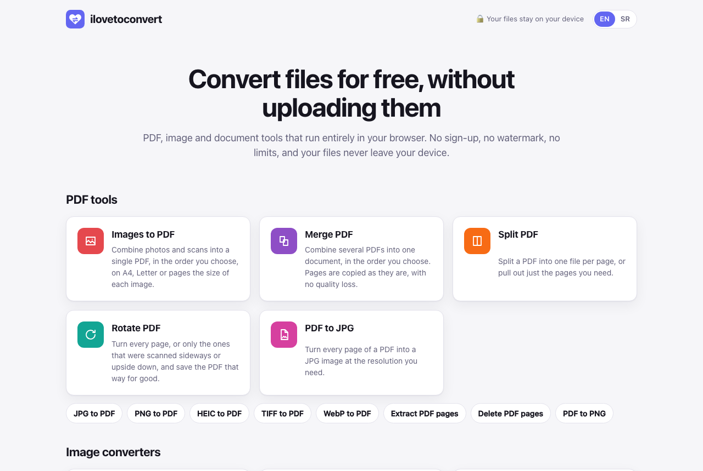
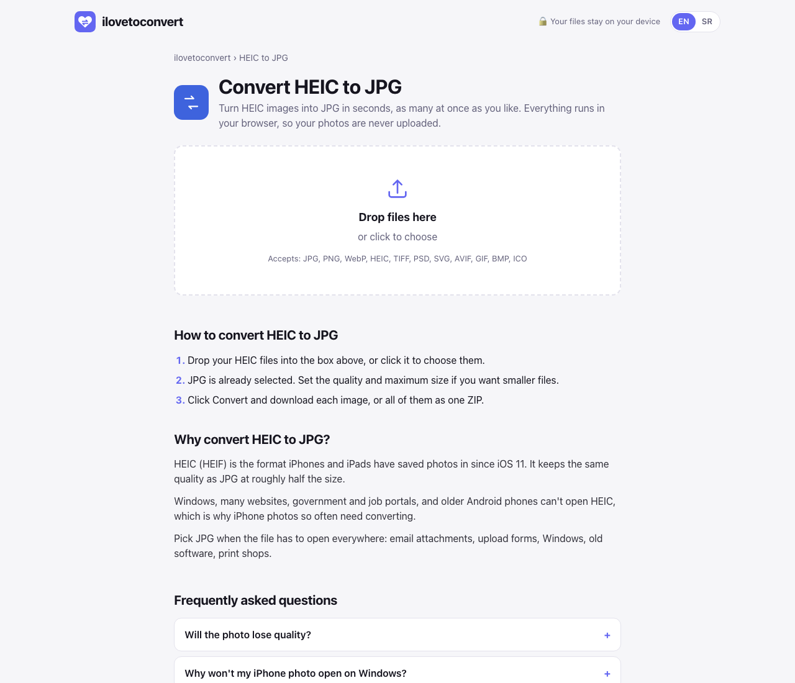

# ilovetoconvert

Free PDF, image and document converter that runs entirely in your browser. Files are never uploaded, because there's no server to upload them to. No sign-up, no watermark, no limits, no tracking.

**Live: [ilovetoconvert.vercel.app](https://ilovetoconvert.vercel.app)**



## What it does

| Tool | Reads | Writes |
| --- | --- | --- |
| [Images to PDF](https://ilovetoconvert.vercel.app/images-to-pdf) | JPG, PNG, WebP, **HEIC** (iPhone), **multi-page TIFF**, **PSD**, **SVG**, **AVIF**, GIF, BMP, ICO | One PDF in the order you choose; A4, Letter or image-sized pages; automatic orientation |
| [Word to PDF](https://ilovetoconvert.vercel.app/word-to-pdf) | .docx, **Markdown**, plain text | PDF with real, selectable text, headers, footers, tables and images |
| [Excel to PDF](https://ilovetoconvert.vercel.app/excel-to-pdf) | .xlsx, .xls, **.ods**, **CSV** | PDF with every sheet, landscape or portrait |
| [Merge PDF](https://ilovetoconvert.vercel.app/merge-pdf) | PDFs | One PDF |
| [Split PDF](https://ilovetoconvert.vercel.app/split-pdf) | PDF + ranges like `1-3, 5, 8-` | One PDF per page, chosen pages, or the PDF minus pages you delete |
| [Rotate PDF](https://ilovetoconvert.vercel.app/rotate-pdf) | PDF | All pages or only the ones you pick |
| [PDF to JPG / PNG](https://ilovetoconvert.vercel.app/pdf-to-jpg) | PDF | One image per page at 72, 150 or 300 dpi |
| [Image converter](https://ilovetoconvert.vercel.app/image-converter) | everything above | JPG, PNG, WebP, or an **ICO favicon** with 16 to 256 px inside |

Those eight tools sit behind 42 landing pages, one per conversion people search for: [HEIC to JPG](https://ilovetoconvert.vercel.app/heic-to-jpg), [PSD to PNG](https://ilovetoconvert.vercel.app/psd-to-png), [TIFF to PDF](https://ilovetoconvert.vercel.app/tiff-to-pdf), [favicon generator](https://ilovetoconvert.vercel.app/favicon-generator) and so on. Each page opens its tool with the right preset.



## How it works

- **PDF editing** with [pdf-lib](https://pdf-lib.js.org): pages are copied, rotated and removed without re-rendering, so text, links and quality stay exactly as they were.
- **PDF rendering** with [pdf.js](https://mozilla.github.io/pdf.js/), the legacy build on purpose: the modern one calls `Map.prototype.getOrInsertComputed`, which browsers don't ship yet.
- **Images** go through a canvas, so phone photos come out upright. HEIC is decoded with libheif ([heic2any](https://github.com/alexcorvi/heic2any)), TIFF with [UTIF](https://github.com/photopea/UTIF.js) (every page, previews skipped), PSD with [ag-psd](https://github.com/Agamnentzar/ag-psd) using the flattened image Photoshop stores. ICO files are written by hand: a directory plus one PNG per size.
- **Word, Markdown and spreadsheets** are laid out as HTML ([docx-preview](https://github.com/VolodymyrBaydalka/docxjs), [marked](https://marked.js.org), [SheetJS](https://sheetjs.com)) and saved by the browser's own print engine, which is why the PDF has real text instead of a picture of text. Word bullets drawn with Symbol/Wingdings characters are swapped for real ones, and each Word page prints at its own paper size.
- Heavy libraries load only when their tool runs. A landing page is about 12 KB of HTML plus about 85 KB of gzipped JavaScript.

## SEO

Every route is prerendered at build time (`react-dom/static`), so crawlers get complete HTML: title, meta description, canonical URL, Open Graph and Twitter cards, and JSON-LD (`WebApplication`, `BreadcrumbList`, `FAQPage`, `HowTo`, plus `WebSite` and an `ItemList` of tools on the home page). The build also writes `sitemap.xml`, `robots.txt` and a real `404.html`. Unknown paths return a 404 status, not the home page.

The site URL used in canonicals, Open Graph and the sitemap comes from `VITE_SITE_URL` (default `https://ilovetoconvert.vercel.app`). When the domain changes, set that variable in Vercel and redeploy.

## Run it

```bash
npm install
npm run dev       # http://localhost:5173 (client-rendered)
npm test          # unit tests: page ranges, layout, PDF operations, ICO
npm run build     # type-check, client + SSR build, prerender into dist/
```

`dist/` is a static site. `vercel.json` turns on clean URLs (`/heic-to-jpg` serves `heic-to-jpg.html`).

The old binary `.doc` format can't be read in a browser; the Word tool says so and explains how to save it as `.docx`.

## License

MIT · made by [Stefan Popović](https://popzify.com/links)
